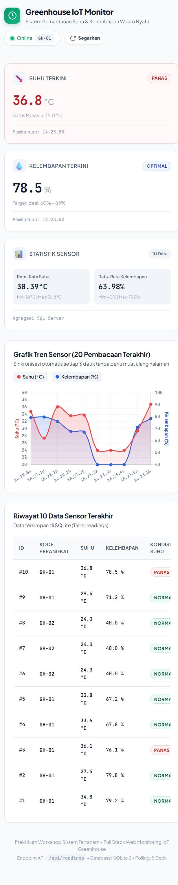
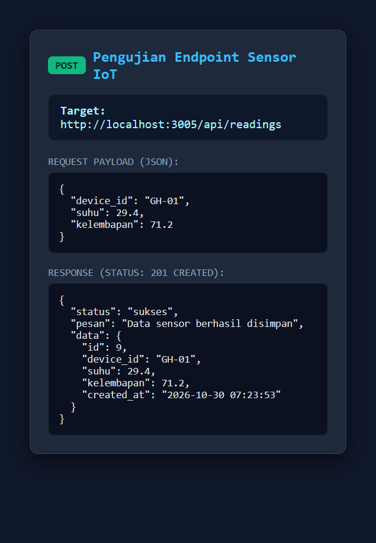

# Web Monitoring IoT Full Stack - Greenhouse System

Aplikasi web monitoring IoT end-to-end yang menerima data sensor suhu dan kelembapan dari perangkat atau simulator mikrokontroler (ESP32/Wokwi), menyimpannya ke database relasional SQLite, dan menyajikannya secara waktu nyata (*real-time*) melalui dashboard interaktif.

Proyek ini dibangun untuk memenuhi **Tugas Praktikum Workshop Sistem Tertanam** dengan mengacu pada kurikulum [roadmap.sh/full-stack](https://roadmap.sh/full-stack).

---

## Identitas Kelompok & Mahasiswa
- **Mata Kuliah**: Workshop Sistem Tertanam
- **Kelompok**: Kelompok 5_C
- **Kelas**: 2C / Sistem Tertanam
- **Repository**: [https://github.com/alviansyahny/iot-monitoring--kelompok-5_c-](https://github.com/alviansyahny/iot-monitoring--kelompok-5_c-)

---

## Arsitektur & Teknologi (Tech Stack)

| Komponen | Teknologi | Keterangan |
|---|---|---|
| **Frontend Dashboard** | HTML5, CSS3, JavaScript Vanilla | Antarmuka responsif tanpa reload (polling 5 detik) |
| **Data Visualization** | Chart.js via CDN | Grafik tren garis suhu dan kelembapan real-time |
| **Backend Framework** | Node.js + Express.js | RESTful API server dengan validasi input |
| **Database** | SQLite3 (`better-sqlite3`) | Penyimpanan deret waktu (*time-series*) mode WAL |
| **IoT Simulator / Hardware** | `simulator.js` / ESP32 + DHT22 | Pengiriman data otomatis via HTTP POST |
| **Tunnel / Hosting** | Cloudflare Tunnel (`cloudflared`) | Akses publik via `https://iot.walker880.my.id` |

---

## Fitur Utama

1. **Dashboard Monitoring Real-Time**:
   - **Kartu Nilai Sensor**: Menampilkan nilai suhu dan kelembapan terkini beserta timestamp pembaruan.
   - **Logika Indikator Suhu**: Kartu berubah warna merah dan berstatus **"Panas"** jika suhu $> 35.0^\circ\text{C}$, serta hijau jika **"Normal"**.
   - **Status Perangkat**: Otomatis mendeteksi status **"Online"** jika data terakhir diterima $< 30$ detik, dan **"Offline"** jika sebaliknya.
2. **Visualisasi Data Dinamis**:
   - Grafik interaktif Chart.js menampilkan tren 20 pembacaan data terakhir dengan skala sumbu ganda (*dual axis*).
   - Tabel riwayat menampilkan 10 pembacaan sensor terakhir yang tersimpan di database.
3. **Penyimpanan Terstruktur**:
   - Tabel `readings` menyimpan `id`, `device_id`, `suhu`, `kelembapan`, dan `created_at`.
4. **Simulator Sensor**:
   - Skrip mandiri yang menghasilkan data acak suhu (25–37 °C) dan kelembapan (60–85 %) setiap 5 detik.

---

## Dokumentasi REST API

Semua respons endpoint menggunakan format JSON.

| Method | Endpoint | Deskripsi | Status Code | Format Respons |
|---|---|---|---|---|
| `POST` | `/api/readings` | Menerima data sensor dari perangkat/simulator | `201 Created` / `400 Bad Request` | Objek JSON data tersimpan |
| `GET` | `/api/readings/latest` | Mengambil 1 data pembacaan paling baru | `200 OK` | Objek JSON reading terbaru |
| `GET` | `/api/readings?limit=20` | Mengambil riwayat N data terakhir | `200 OK` | Array JSON riwayat reading |
| `GET` | `/api/stats` | Agregasi statistik (avg, min, max) | `200 OK` | Objek JSON kalkulasi statistik |

### Contoh Request & Payload POST
```http
POST /api/readings HTTP/1.1
Host: localhost:3005
Content-Type: application/json

{
  "device_id": "GH-01",
  "suhu": 29.4,
  "kelembapan": 71.2
}
```

### Aturan Validasi Input:
- Permintaan ditolak dengan status **`400 Bad Request`** jika:
  - `device_id` tidak diisi atau bukan string.
  - `suhu` atau `kelembapan` bukan berupa angka valid.
  - `suhu` berada di luar rentang batas sensor ($-40^\circ\text{C}$ s.d. $80^\circ\text{C}$).
  - `kelembapan` berada di luar rentang ($0\%$ s.d. $100\%$).

---

## Cara Menjalankan Proyek

### 1. Prasyarat
- Node.js (v18 ke atas) & npm
- Git

### 2. Instalasi Dependensi
Clone repository dan pasang pustaka yang diperlukan:
```bash
git clone https://github.com/alviansyahny/iot-monitoring--kelompok-5_c-.git
cd iot-monitoring--kelompok-5_c-
npm install
```

### 3. Menjalankan Server Backend (Terminal 1)
```bash
node server.js
```
Server akan aktif dan dapat diakses melalui browser di:
`http://localhost:3005` (atau `http://localhost:3000`)

### 4. Menjalankan Simulator Perangkat (Terminal 2)
Buka terminal baru di folder yang sama, lalu jalankan:
```bash
node simulator.js
```
Simulator akan mulai mengirimkan data sensor setiap 5 detik ke backend.

---

## Tangkapan Layar Pengujian

### 1. Tampilan Dashboard Web Monitoring


### 2. Uji Endpoint REST API (POST /api/readings)

